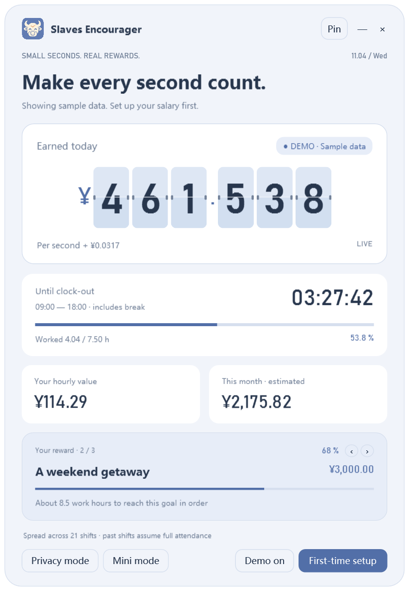
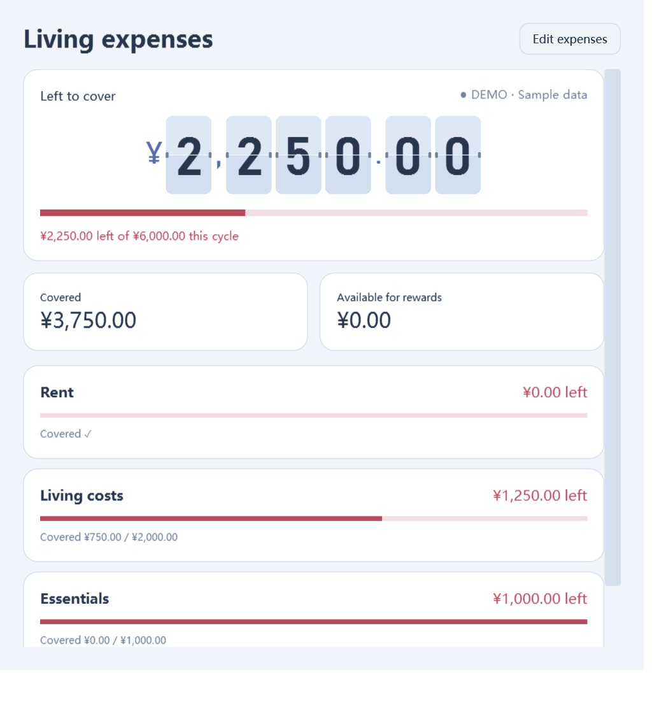

<p align="center"></p>

# Slaves Encourager

<p align="center">
  <a href="https://github.com/thisemailrectrash-cpu/slaves-encourager/actions/workflows/windows.yml"></a>
  <a href="LICENSE"></a>
  <a href="https://github.com/thisemailrectrash-cpu/slaves-encourager/releases/latest"></a>
</p>

<p align="center"><a href="README.md">简体中文</a> · <a href="README.zh-Hant.md">繁體中文</a> · <strong>English</strong> · <a href="README.ja.md">日本語</a> · <a href="README.es.md">Español</a> · <a href="README.ko.md">한국어</a></p>

<p align="center"><a href="https://github.com/thisemailrectrash-cpu/slaves-encourager/releases/latest"><strong>Download for Windows</strong></a></p>

<p align="center"></p>
<p align="center"><sub>Real app interface · Built-in sample data · Six languages</sub></p>

Edit any fixed home caption: double-click text, or right-click a button and choose **Edit home text** (`Ctrl+E`). Save, cancel, reset one entry or reset the current language. Edits persist independently per language. See [Home text](docs/HOME_TEXT.md).

A local-first Windows earnings clock: see your time turn into small rewards.




## Pay cycles and living expenses (1.4.0)

Choose a reset day from 1–31 (default: 1). Day 15 means the 15th through the next month's 14th; short months use their last day. Income, expense coverage and goals reset at midnight on that day.

Living expenses are hidden by default. Enable them in first-time salary settings and customize up to 20 names, amounts and priorities. Red bars show the uncovered share and shrink as income increases. Income covers expenses before reward goals. Turning the feature off keeps the saved list.

On first setup, enabling expenses mid-cycle or changing the reset day, saving asks you to confirm estimated earnings so far. Edit the amount or start from 0; only income after confirmation is added. “Adjust earnings so far…” lets you correct it later. The opening amount expires next cycle. Allocations are estimates, not bill payments. [Full rules](docs/EXPENSES.md).




## Features

- Flip-clock, smooth-slide and static numbers; 0–4 decimals, grouping, currency symbols and custom templates.
- A new ox-and-clock icon with a soft blue, ivory and apricot palette. Three themes and three number fonts.
- Simplified Chinese, Traditional Chinese, English, Japanese, Spanish and Korean, with system detection and saved language selection.
- Clickable days off and extra shifts, weekly schedules, breaks and overnight shifts.
- Up to 20 ordered goals. Estimated income first covers enabled expenses, then goals in list order.
- Pin, mini mode, privacy mode and system tray. Drag any non-button area of the main window.
- Salary works offline; no telemetry or account connections. [MIT licensed](LICENSE).

## Use

Windows 10/11 with .NET Framework 4.8. Extract the portable ZIP and run `SlavesEncourager.exe`.

First launch uses clearly labelled sample data. Open **First-time setup**, enter your salary and schedule, mark calendar exceptions, add goals and save. The language selector is at the top right of settings; cancelling restores the previous language. User-written goal names and amount templates are never translated automatically.

`Ctrl+M` toggles mini mode; `Ctrl+Shift+P` toggles privacy while the window has focus. “—” hides to the tray; double-click its icon to restore. “×” quits.

## Estimates and data

Salary is divided by this pay cycle's scheduled workdays, or an optional fixed 21.75-day basis. Breaks are excluded. Past scheduled days assume full attendance. No tax, bonus, overtime or actual attendance deductions are calculated. Overnight shifts belong to their starting date. Add holidays according to your own schedule. Currency selection changes symbols only.

Goal progress uses pay-cycle estimated income, not savings. For goals of 1,000 and 3,000, income of 1,500 allocates 1,000 and 500. Progress resets on your pay-cycle day. With expenses enabled, only the surplus after expenses funds goals.

Settings stay in `%LOCALAPPDATA%\SlavesEncouragerStockBeta\settings.json`, a separate beta path that leaves stable settings untouched. Saves keep a `.bak`; settings are not encrypted. Privacy mode hides amounts on screen.

## Web edition (beta)

`web/` ports the app to the browser with identical calculations, six languages and settings layout; data stays in your browser. Install it as an offline PWA or package an Android APK with Capacitor.

```bash
cd web && npm install && npm run dev
```

See [the web guide](docs/WEB.md).

## Build

Prefer the Windows container workflow: `./scripts/build.ps1`. If unavailable, use the existing Windows compiler:

```powershell
./scripts/build.ps1 -Native -VisualCheck
python scripts/validate.py
python scripts/package.py
```

The app and ZIPs are written to `dist/`; checks and six-language renders go to `.build/`. No third-party application packages are required. The [CI workflow](https://github.com/thisemailrectrash-cpu/slaves-encourager/actions/workflows/windows.yml) builds, tests and packages the app on Windows. The badge above shows the current main-branch status.

[Development](docs/DEVELOPMENT.md) · [Contributing](CONTRIBUTING.md) · [Publishing](docs/GITHUB_PUBLISH.md) · [Changelog](CHANGELOG.md) · [Icon provenance](docs/ICON.md) · [MIT](LICENSE)
