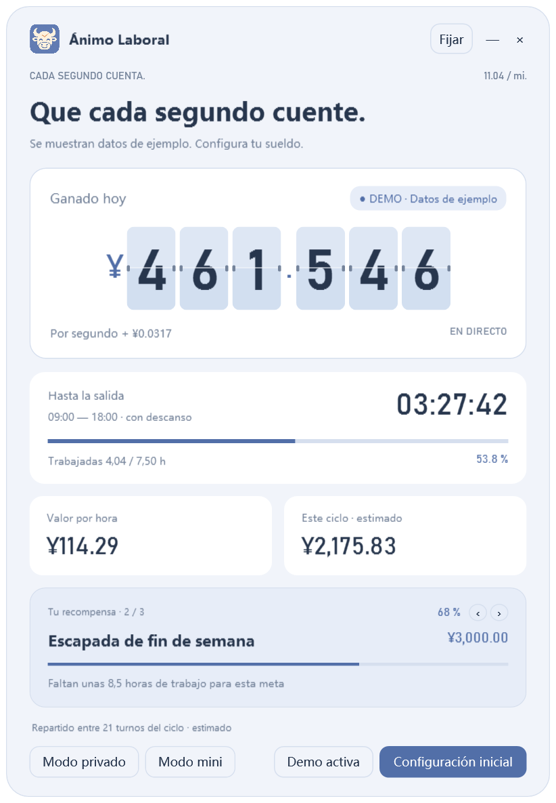

# 1.5.0-beta.4 · Acciones y posiciones de EE. UU. · Versión preliminar pública

**Versión macOS**: proyectos nativos para Apple Silicon e Intel con las funciones de Windows beta.4, en la misma Release. [Instalación y funciones](docs/MACOS.md).

Los valores están ocultos por defecto. La configuración inicial pregunta si activarlos: Sí abre la pestaña Valores; Ahora no abre el sueldo. Añade, edita, elimina o importa allí; al guardar aparecen al final del inicio. La ventana crece; en pantallas bajas se ajusta el contenido sin desplazamiento. Desactivar pausa las consultas y conserva los datos.

Nuevo: **añade símbolos directamente**, como `AAPL, MSFT, NVDA`, para ver precios, cambios y horas sin introducir acciones. Cambia al modo posición para estimar el resultado. Añade varios, edita o elimina; la lista no cuenta como acciones propias. [Guía](docs/STOCK_BETA.md).

**[Descargar la versión preliminar 1.5.0-beta.4](https://github.com/thisemailrectrash-cpu/slaves-encourager/releases/tag/v1.5.0-beta.4)**. Las funciones bursátiles son experimentales; falta validar páginas reales de brókeres y el uso de la extensión. No está en una tienda. [La estable 1.4.0](https://github.com/thisemailrectrash-cpu/slaves-encourager/releases/tag/v1.4.0) sigue disponible; los enlaces generales de abajo apuntan a la estable.

Cuatro métodos: CSV/Excel, tablas pegadas, OCR local de Windows y extensión. Revisa y confirma la cartera fija antes de activar precios Yahoo experimentales. El resultado estimado de la última sesión queda separado del sueldo, gastos y metas. Sin conexión al bróker ni órdenes. Carga manualmente `browser-extension`.

[Guía, cálculos, límites y revisión](docs/STOCK_BETA.md). Usa el EXE/ZIP local de la beta y prueba primero los ejemplos ficticios.

# Ánimo Laboral / Slaves Encourager

  
  
  

<a href="README.md">简体中文</a> · <a href="README.zh-Hant.md">繁體中文</a> · <a href="README.en.md">English</a> · <a href="README.ja.md">日本語</a> · <strong>Español</strong> · <a href="README.ko.md">한국어</a>

<a href="https://github.com/thisemailrectrash-cpu/slaves-encourager/releases/latest"><strong>Descargar para Windows</strong></a>

Interfaz real · Datos de ejemplo · Seis idiomas

Edita los textos fijos con doble clic, o con clic derecho en un botón (`Ctrl+E`). Guarda, cancela o restaura un texto o el idioma actual. Los cambios se guardan por idioma. [Guía](docs/HOME_TEXT.md).

Convierte tu tiempo en pequeñas recompensas: reloj de ingresos, cuenta atrás hasta la salida, calendario laboral y metas para Windows.

## Ciclos salariales y gastos (1.4.0)

Elige el día de inicio del 1 al 31 (por defecto, 1). El día 15 abarca del 15 al 14 siguiente; en meses cortos se usa el último día. Ingresos, gastos y metas se reinician a medianoche.

Los gastos están ocultos inicialmente. Actívalos en la configuración salarial y personaliza hasta 20 nombres, importes y prioridades. Las barras rojas muestran lo pendiente y bajan al aumentar el ingreso. Primero se cubren gastos y después recompensas. Desactivar conserva la lista guardada.

Al configurar por primera vez, activar gastos a mitad del ciclo o cambiar el día, se confirma lo acumulado antes de guardar. Puedes corregirlo o empezar desde 0; solo se suma lo ganado después. Puedes corregirlo más tarde desde los ajustes salariales; el importe inicial caduca al siguiente ciclo. Son asignaciones estimadas, no pagos. [Reglas completas](docs/EXPENSES.md).

## Uso

Requiere Windows 10/11 y .NET Framework 4.8. Extrae el ZIP y abre `SlavesEncourager.exe`. El sueldo funciona sin conexión; las cotizaciones son opcionales. No inicia sesión en el bróker ni envía telemetría.

El primer inicio muestra datos de ejemplo. Abre «Configuración inicial», introduce tu sueldo y horario, marca descansos o turnos extra en el calendario y guarda. Puedes añadir hasta 20 metas y cambiar su orden. El selector de idioma está arriba a la derecha; la selección se guarda y cancelar restaura el idioma anterior.

Elige animación de solapas, deslizamiento o cifras estáticas, decimales, separadores y plantillas. Arrastra cualquier zona de la ventana principal que no sea un botón. `Ctrl+M` activa el modo mini y `Ctrl+Shift+P` oculta los importes mientras la ventana está activa. «—» oculta en la bandeja y «×» cierra.

## Cálculos y datos

El sueldo se reparte entre los días programados del ciclo salarial o sobre una base fija de 21,75 días. Los descansos se excluyen; los turnos pasados se consideran completos. No calcula impuestos, primas, horas extra ni asistencia real. Marca los festivos según tu horario. Los turnos nocturnos pertenecen a la fecha de inicio. La moneda solo cambia el símbolo.

El ingreso estimado del ciclo se reparte entre las metas por orden, sin duplicarlo, y el progreso se reinicia al empezar cada ciclo salarial. No representa ahorros reales.

Los ajustes se guardan en `%LOCALAPPDATA%\SlavesEncouragerStockBeta\settings.json`, una ruta beta separada de la versión estable. No están cifrados; cada guardado conserva una copia `.bak`.

## Desarrollo y licencia

Se prefiere el contenedor Windows: `./scripts/build.ps1`. Como alternativa con el compilador ya instalado: `./scripts/build.ps1 -Native -VisualCheck`, seguido de `python scripts/validate.py` y `python scripts/package.py`.

[Licencia MIT](LICENSE) · [Desarrollo](docs/DEVELOPMENT.md) · [Contribuir](CONTRIBUTING.md) · [Cambios](CHANGELOG.md)
