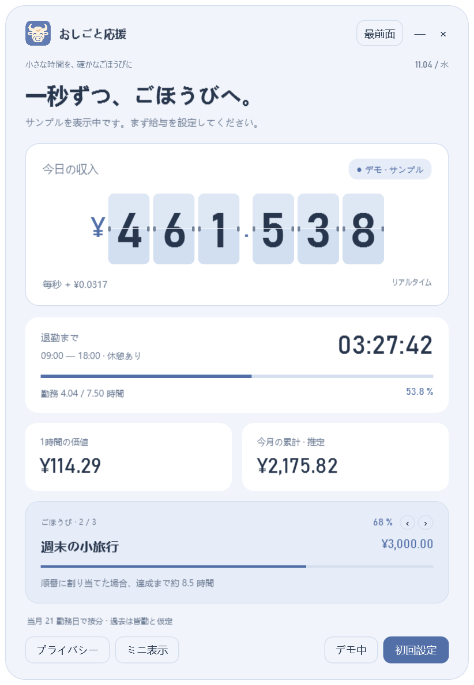

# おしごと応援 / Slaves Encourager

ホームの固定文字をダブルクリック、またはボタンを右クリックして編集できます（`Ctrl+E`）。保存・キャンセル・項目や現在の言語のリセットに対応。変更は言語ごとに保存されます。[説明](docs/HOME_TEXT.md)。

がんばる時間を、見えるごほうびに。Windows用の収入時計、退勤カウントダウン、勤務カレンダー、目標リストです。

[简体中文](README.md) · [繁體中文](README.zh-Hant.md) · [English](README.en.md) · **日本語** · [Español](README.es.md) · [한국어](README.ko.md)

## はじめに

Windows 10/11と.NET Framework 4.8が必要です。ZIPを展開し、`SlavesEncourager.exe`を実行します。アカウントやインターネット接続は不要です。

初回はデモ表示です。「初回設定」で月給と勤務時間を入力し、カレンダーで休日や追加出勤を指定して保存してください。目標は20個まで追加でき、順番の変更や切り替えができます。設定の右上で6言語を選択でき、保存した言語は次回も使われます。キャンセルすると元の言語に戻ります。

フリップ時計、スクロール、静止表示を選べます。小数桁数、桁区切り、通貨記号、書式も変更できます。メイン画面はボタン以外をドラッグして移動できます。

`Ctrl+M`でミニ表示、`Ctrl+Shift+P`で金額を非表示にします。ショートカットは画面が選択されているときに有効です。「—」で通知領域へ、「×」で終了します。

## 推定値について

月給を当月の勤務日数、または固定21.75日で按分します。休憩は除き、過去の勤務日は皆勤として計算します。税金、賞与、残業代、実際の勤怠は計算しません。祝日は自分の勤務予定に合わせて指定してください。日またぎ勤務は開始日に属します。通貨の変更は記号のみで、為替換算はしません。

目標には今月の推定収入を順番に割り当て、重複計上しません。毎月リセットされ、貯金残高を示すものではありません。

設定は互換性維持のため`%LOCALAPPDATA%\NiumaFlip\settings.json`に保存します。暗号化はされず、保存時に`.bak`を残します。

## 開発

Windowsコンテナーを優先します：`./scripts/build.ps1`。利用できない場合は既存のコンパイラーで`./scripts/build.ps1 -Native -VisualCheck`を実行し、`python scripts/validate.py`と`python scripts/package.py`で検証・作成できます。

[MITライセンス](LICENSE) · [開発ガイド](docs/DEVELOPMENT.md) · [貢献ガイド](CONTRIBUTING.md) · [変更履歴](CHANGELOG.md)
