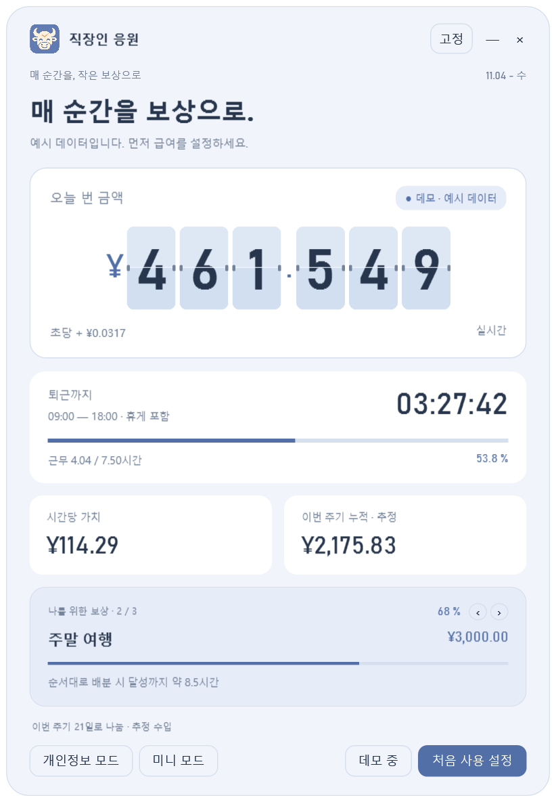

# 1.5.0-beta.4 · 미국 주식 모니터링과 보유 종목 · 공개 미리 보기

**macOS 버전**: Windows beta.4와 같은 기능의 Apple Silicon 및 Intel 네이티브 프로젝트이며 같은 Release에서 배포합니다. [설치 및 기능](docs/MACOS.md).

주식 기능은 기본 숨김입니다. 최초 설정에서 켤지 물으며 켜면 전용 주식 탭, 나중에를 선택하면 급여 설정으로 이동합니다. 주식 탭에서 추가·편집·제거·가져오기를 하고 저장하면 홈 맨 아래에 표시됩니다. 창 높이가 늘어나며 작은 화면은 본문을 축소해 스크롤 없이 보여 줍니다. 끄면 시세 요청을 일시 중지하고 저장 데이터는 유지합니다.

추가: `AAPL, MSFT, NVDA`처럼 **코드만으로 관심 종목을 추가**해 가격, 등락률, 시세 시간을 확인하세요. 수량을 입력하면 보유 손익 모드로 전환할 수 있습니다. 일괄 추가, 편집, 제거를 지원하며 관찰 종목은 보유 손익에 포함하지 않습니다. [설명](docs/STOCK_BETA.md).

**[1.5.0-beta.4 미리 보기 다운로드](https://github.com/thisemailrectrash-cpu/slaves-encourager/releases/tag/v1.5.0-beta.4)**. 주식 기능은 실험 단계이며 실제 증권사 페이지와 확장 프로그램 조작은 추가 검증이 필요합니다. 확장 프로그램은 스토어에 등록되지 않았습니다. [안정 버전 1.4.0](https://github.com/thisemailrectrash-cpu/slaves-encourager/releases/tag/v1.4.0)은 유지되며 아래 일반 다운로드 링크는 안정 버전으로 연결됩니다.

CSV/Excel, 표 붙여넣기, Windows 로컬 OCR, 브라우저 확장 네 가지 방식을 지원합니다. 고정 보유량을 확인한 뒤 Yahoo 실험 시세를 선택해 켤 수 있습니다. 최근 거래일 추정 손익은 급여, 생활비, 목표와 별도로 표시합니다. 증권 계좌 연결이나 주문은 없습니다. `browser-extension` 폴더를 수동으로 로드하세요.

[사용 단계, 계산, 제한 및 검토 항목](docs/STOCK_BETA.md). 로컬 베타 EXE/ZIP을 사용하고 먼저 가상 예시로 테스트하세요.

# 직장인 응원 / Slaves Encourager

  
  
  

<a href="README.md">简体中文</a> · <a href="README.zh-Hant.md">繁體中文</a> · <a href="README.en.md">English</a> · <a href="README.ja.md">日本語</a> · <a href="README.es.md">Español</a> · <strong>한국어</strong>

<a href="https://github.com/thisemailrectrash-cpu/slaves-encourager/releases/latest"><strong>Windows 버전 다운로드</strong></a>

실제 앱 화면 · 예시 데이터 · 6개 언어 전환

고정된 홈 문구를 두 번 클릭하거나 버튼을 우클릭해 편집하세요 (`Ctrl+E`). 저장·취소·개별 문구 또는 현재 언어 복원을 지원하며 언어별로 저장됩니다. [설명](docs/HOME_TEXT.md).

열심히 보낸 시간을 작은 보상으로 바꿔 보세요. Windows용 수입 시계, 퇴근 카운트다운, 근무 달력과 목표 목록입니다.

## 급여 주기와 생활비 (1.4.0)

시작일은 1~31일 중 선택하며 기본값은 1일입니다. 15일이면 15일부터 다음 달 14일까지이며 짧은 달은 말일을 사용합니다. 시작일 자정에 수입, 생활비 충당, 목표를 초기화합니다.

생활비는 기본적으로 숨겨져 있습니다. 최초 급여 설정에서 켜고 이름, 금액, 순서를 최대 20개까지 편집하세요. 빨간 막대는 미충당 비율이며 수입이 늘면 짧아집니다. 생활비를 먼저 충당한 뒤 나머지를 보상에 배분합니다. 꺼도 저장한 목록은 유지됩니다.

최초 설정, 주기 중 생활비 활성화, 시작일 변경 시 저장 전에 누적 수입을 확인합니다. 금액을 수정하거나 0으로 시작하면 확인 이후 수입만 더합니다. 급여 설정에서 다시 수정할 수 있으며 다음 주기에 초기화됩니다. 실제 결제가 아닌 추정 배분입니다. [전체 규칙](docs/EXPENSES.md).

## 사용 방법

Windows 10/11 및 .NET Framework 4.8이 필요합니다. ZIP을 풀고 `SlavesEncourager.exe`를 실행하세요. 급여는 오프라인으로 작동하며 시세 연결은 선택 사항입니다. 증권 계좌 로그인과 원격 측정은 없습니다.

처음에는 데모 데이터가 표시됩니다. «처음 사용 설정»에서 월급과 근무 시간을 입력하고 달력에서 휴일과 추가 근무를 지정한 다음 저장하세요. 목표는 최대 20개까지 추가하고 순서를 바꿀 수 있습니다. 설정 오른쪽 위에서 6개 언어를 선택할 수 있으며 저장하면 유지됩니다. 취소하면 원래 언어로 돌아갑니다.

플립 시계, 슬라이드, 정적 숫자 효과를 선택하고 소수 자릿수, 구분 기호, 통화 기호와 표시 형식을 조정하세요. 주 창의 버튼 외 영역을 드래그하면 이동합니다. 창이 활성화된 상태에서 `Ctrl+M`은 미니 모드, `Ctrl+Shift+P`는 금액 숨기기입니다. «—»는 트레이로 숨기고 «×»는 종료합니다.

## 계산 및 저장

월급을 이번 주기 근무일 수 또는 고정 21.75일 기준으로 나눕니다. 휴게 시간은 제외하고 지난 근무일은 만근으로 추정합니다. 세금, 상여금, 초과 근무 수당과 실제 근태는 계산하지 않습니다. 휴일은 회사 일정에 맞게 지정하세요. 야간 근무는 시작 날짜에 속하며 통화 선택은 기호만 바꿉니다.

목표에는 이번 주기 추정 수입을 목록 순서대로 한 번씩 배분합니다. 급여 주기 시작일에 초기화되며 실제 저축 잔액이 아닙니다.

설정은 안정 버전과 분리하여 `%LOCALAPPDATA%\SlavesEncouragerStockBeta\settings.json`에 저장합니다. 암호화되지 않으며 저장 시 `.bak` 사본을 남깁니다.

## 개발 및 라이선스

Windows 컨테이너를 우선 사용합니다: `./scripts/build.ps1`. 사용할 수 없다면 기존 컴파일러로 `./scripts/build.ps1 -Native -VisualCheck`를 실행하고 `python scripts/validate.py`, `python scripts/package.py`로 검사 및 패키징하세요.

[MIT 라이선스](LICENSE) · [개발 안내](docs/DEVELOPMENT.md) · [기여 안내](CONTRIBUTING.md) · [변경 기록](CHANGELOG.md)
