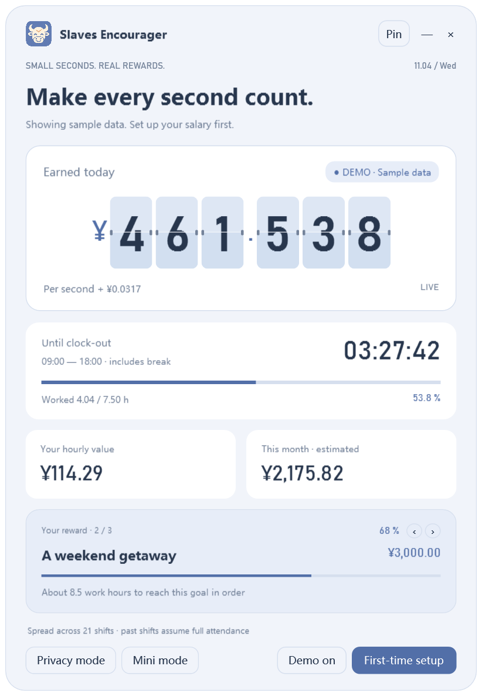

# 牛马鼓励器 / Slaves Encourager

<p align="center">
  <a href="https://github.com/thisemailrectrash-cpu/slaves-encourager/actions/workflows/windows.yml"></a>
  <a href="LICENSE"></a>
  <a href="https://github.com/thisemailrectrash-cpu/slaves-encourager/releases/latest"></a>
</p>

<p align="center"><strong>简体中文</strong> · <a href="README.zh-Hant.md">繁體中文</a> · <a href="README.en.md">English</a> · <a href="README.ja.md">日本語</a> · <a href="README.es.md">Español</a> · <a href="README.ko.md">한국어</a></p>

<p align="center"><a href="https://github.com/thisemailrectrash-cpu/slaves-encourager/releases/latest"><strong>下载 Windows 便携版</strong></a></p>

<p align="center"></p>
<p align="center"><sub>真实应用界面 · 内置示例数据 · 六语言切换</sub></p>

主页固定文字支持直接修改：双击文字，或右键按钮选择「编辑主页文字」（`Ctrl+E`）。支持保存、取消、恢复单项和恢复当前语言，修改按语言独立保存。详见[文字编辑说明](docs/HOME_TEXT.md)。

把工作时间变成看得见的小奖励。一个支持翻页数字、收入估算、下班倒计时、排班日历和多个目标的 Windows 桌面悬窗。


 

<p align="center"></p>

## 工资周期与生活开支（1.4.0）

工资结算日可选 1–31 日，默认 1 日；例如选 15 日，本期就是 15 日至下月 14 日，短月份按月末。结算日零点重置收入、开支覆盖和奖励目标。

生活开支默认隐藏。在第一次使用设置中勾选后，可添加租金、生活费等最多 20 个项目，自定名称、金额和顺序。红条代表待覆盖比例，收入增加时逐渐缩短；先覆盖全部开支，余额再推进奖励。关闭功能会保留已保存清单。

首次设置、中途开启开支或更改结算日，保存时会确认“此前已累计约 ¥xxxx”。可接受估算、手动改金额，或从 0 开始，之后仅继续累计确认时刻以后的排班收入。也可在工资设置中点“校正本期已累计收入…”；下个周期自动重置。

 

详见[开支与工资周期说明](docs/EXPENSES.md)。覆盖仅代表估算收入分配，不代表账单已支付；设置、金额和进度都在本机处理。


## 特色

- 翻页时钟、滑动、静态三种数字样式；0–4 位小数、千分位、币种符号和自定义模板。
- 全新「牛角＋时钟」图标；雾蓝暖杏、暮色薰衣草、奶油纸张三套配色。
- 简体中文、繁体中文、英语、日语、西班牙语、韩语；支持跟随系统、即时预览和保存语言选择。
- 工作日、固定休息、跨午夜班次；直接点击日历设置休息和补班。
- 最多 20 个目标，可编辑、删除、排序和切换查看；本期收入先覆盖已启用的生活开支，再按目标清单分配。
- 置顶、迷你模式、隐私模式、托盘；主窗口任意非按钮区域都能拖动。
- 工资本地运行，无遥测或账号连接；源码采用 [MIT 许可证](LICENSE)。

## 开始使用

支持 Windows 10/11，需要系统已有 **.NET Framework 4.8**。解压便携包后双击 `SlavesEncourager.exe`。

1. 首次显示明确标记的示例数据，点击「第一次使用设置」。
2. 在「工资与排班」填写月薪、工资结算日、工作日、上下班时间和固定休息；生活开支默认关闭，可按需开启。
3. 在「休息与补班」选择操作，再点日期；同一模式再点一次可取消。
4. 在「目标与使用」新增奖励、填写金额，并调整先后顺序。
5. 点「保存并应用」，确认本期此前已累计的估算收入，可修改金额或从 0 开始；取消确认会返回设置。语言可在右上角切换。

`Ctrl+M` 切换迷你模式，`Ctrl+Shift+P` 切换隐私模式，快捷键在窗口获得焦点时生效。「—」隐藏至托盘，双击托盘图标恢复；「×」退出。

设置保存在 `%LOCALAPPDATA%\SlavesEncouragerStockBeta\settings.json`（目录名沿用历史版本，不迁移现有文件）；保存时保留 `.bak`。设置未加密，隐私模式用于隐藏界面金额。

## 计算口径

默认以月薪除以本期排班天数，也可选固定 21.75 天折算。有效时长扣除固定休息，休息和下班后停止累计；每次按当前时间重算，因此休眠或重开不会丢失定时器间隔。

过去排班日默认满勤，不计算个税、奖金、加班费或实际考勤扣款。跨午夜班次归属开始日期。未内置全国节假日，请按自己的公司安排点选日历。币种只改变显示符号，不做汇率换算；自定义金额格式保持用户选择的分隔规则。

目标使用同一份本期估算收入，按列表顺序推进。例如先 1,000、后 3,000，收入为 1,500 时，两个目标分配 1,000 和 500，不重复计数。目标进度并非实际储蓄，在工资结算日重置。开启开支后，先扣除本期开支总额，再把余额分给目标。

## 从源码构建

**网页版（beta）**：`web/` 是浏览器移植，计算口径、六语言与设置契约和桌面版一致，数据仅存于浏览器。可安装为 PWA 离线使用，也可用 Capacitor 打包安卓 APK。

```bash
cd web && npm install && npm run dev
```

详见[网页版说明](docs/WEB.md)。

**Windows 桌面版**——首选 Windows 容器（需 Windows Docker engine）：

```powershell
./scripts/build.ps1
```

开发机 Docker 不可访问时，可使用已安装的 Windows 编译器，不安装系统包：

```powershell
./scripts/build.ps1 -Native -VisualCheck
python scripts/validate.py
python scripts/package.py
```

输出在 `dist/`，验证记录在 `.build/`。视觉检查会加载真实 WPF 界面并逐语言渲染；GitHub Actions 配置执行编译、测试、资源校验和打包，远程运行结果见仓库 Actions 页面。

## 项目结构

```text
src/SlavesEncourager/  桌面界面、计算、日历、目标和本地化
web/                 网页版（Vite + Preact + TypeScript）
locales/catalog.tsv   243 个键 × 6 种语言
assets/              PNG 原图和七档尺寸 ICO
scripts/             构建、校验和白名单打包
tests/               计算、兼容性和语言行为测试
docs/                开发、发布、图标说明和示例截图
.github/workflows/   Windows CI
```

[贡献指南](CONTRIBUTING.md) · [开发说明](docs/DEVELOPMENT.md) · [网页版说明](docs/WEB.md) · [GitHub 发布准备](docs/GITHUB_PUBLISH.md) · [版本记录](CHANGELOG.md) · [图标来源](docs/ICON.md) · [第三方说明](THIRD_PARTY_NOTICES.md)

本项目根据一个公开的 macOS 功能演示独立实现，不含原作者源码、图标或安装包；功能灵感来源见 [公开作品](https://www.douyin.com/note/7703818875581798641)。
