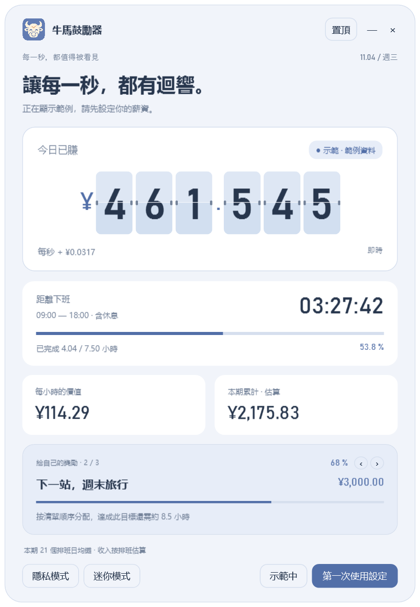

<p align="center"></p>

# 牛馬鼓勵器

<p align="center">
  <a href="https://github.com/thisemailrectrash-cpu/slaves-encourager/actions/workflows/windows.yml"></a>
  <a href="LICENSE"></a>
  <a href="https://github.com/thisemailrectrash-cpu/slaves-encourager/releases/latest"></a>
</p>

<p align="center"><a href="README.md">简体中文</a> · <strong>繁體中文</strong> · <a href="README.en.md">English</a> · <a href="README.ja.md">日本語</a> · <a href="README.es.md">Español</a> · <a href="README.ko.md">한국어</a></p>

<p align="center"><a href="https://github.com/thisemailrectrash-cpu/slaves-encourager/releases/latest"><strong>下載 Windows 便攜版</strong></a></p>

<p align="center"></p>
<p align="center"><sub>實際應用程式畫面 · 內建範例資料 · 六語言切換</sub></p>

主頁固定文字可直接修改：按兩下文字，或以右鍵點按鈕選擇「編輯主頁文字」（`Ctrl+E`）。支援儲存、取消、還原單項與目前語言，各語言分別保存。詳見[文字編輯說明](docs/HOME_TEXT.md)。

把工作時間變成看得見的小獎勵。支援翻頁數字、收入估算、下班倒數、排班日曆與多個目標的 Windows 桌面工具。




## 薪資週期與生活開支（1.4.0）

結算日可選 1–31 日，預設 1 日；例如 15 日至下月 14 日，短月份按月底。結算日零點重置收入、開支與目標。

生活開支預設隱藏，可在首次薪資設定中開啟。最多 20 項，可自訂名稱、金額與順序；收入先覆蓋開支，餘額再進入獎勵。紅條代表待覆蓋比例，隨收入增加而縮短；關閉功能保留已儲存清單。

首次設定、中途開啟開支、更改結算日或修改月薪時，儲存前會確認此前累計收入；修改月薪會按新月俸重新估算本期。可修改或從 0 開始，只續計確認後的收入。亦可在薪資設定中校正，下期自動重置。這是估算分配，並非已付款。[完整說明](docs/EXPENSES.md)。


## 使用

適用於 Windows 10/11，系統需有 .NET Framework 4.8。解壓縮後執行 `SlavesEncourager.exe`，無須安裝其他元件。

首次顯示明確標記的範例，按「第一次使用設定」填寫月薪與排班。在「休息與補班」選擇操作後直接點選日期，再點一次可取消。可新增最多 20 個目標、調整順序及切換查看。設定右上角可切換六種語言，儲存後保留選擇；取消會恢復原語言。

主視窗的非按鈕區域都可拖曳。`Ctrl+M` 切換迷你模式，`Ctrl+Shift+P` 切換隱私模式；快捷鍵在視窗取得焦點時生效。「—」隱藏至系統匣，按兩下圖示恢復；「×」結束。

## 資料與計算

預設按本期排班日分攤月薪，或選固定 21.75 天。休息時段不累計，過去工作日預設全勤。未計算稅款、獎金、加班費及實際考勤；節假日須依公司排班自行點選。跨午夜班次歸開始日期，貨幣選擇只變更符號。

多個目標共用本期估算收入，按清單順序分配，不重複計入，並於薪資結算日重新計算；不是實際存款餘額。

資料僅儲存在本機 `%LOCALAPPDATA%\SlavesEncouragerStockBeta\settings.json`（目錄名沿用歷史版本，不遷移現有檔案）。儲存時保留 `.bak`，設定未加密。

## 網頁版（beta）

`web/` 是瀏覽器移植，計算口徑、六語言與設定契約和桌面版一致，資料僅存於瀏覽器。可安裝為 PWA 離線使用，也可用 Capacitor 打包安卓 APK。

```bash
cd web && npm install && npm run dev
```

詳見[網頁版說明](docs/WEB.md)。

## 開發與授權

首選 Windows 容器 `./scripts/build.ps1`；容器無法使用時，可用既有編譯器執行 `./scripts/build.ps1 -Native -VisualCheck`，再執行 `python scripts/validate.py` 及 `python scripts/package.py`。

程式採 [MIT 授權](LICENSE)。[開發說明](docs/DEVELOPMENT.md) · [貢獻指南](CONTRIBUTING.md) · [版本記錄](CHANGELOG.md)
