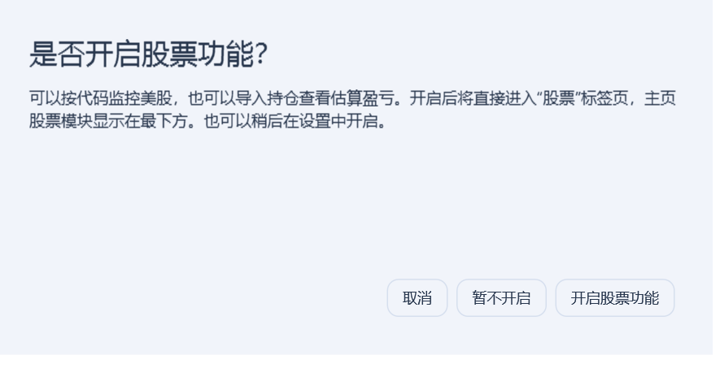
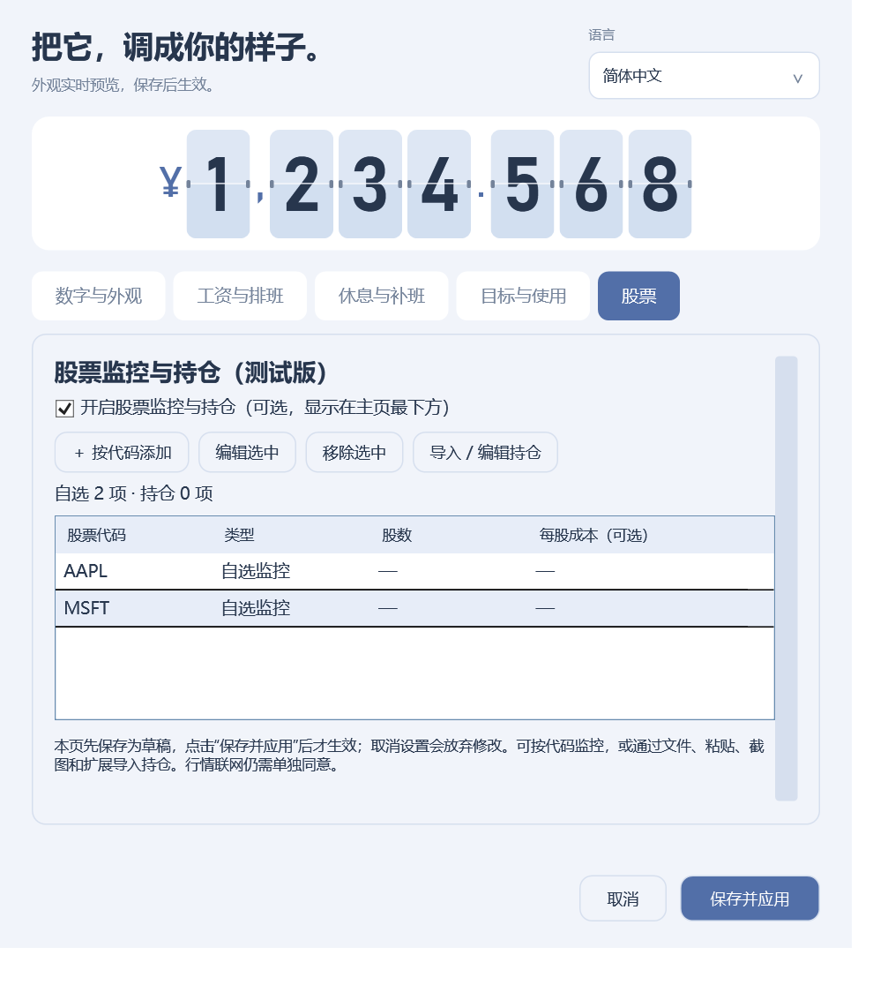
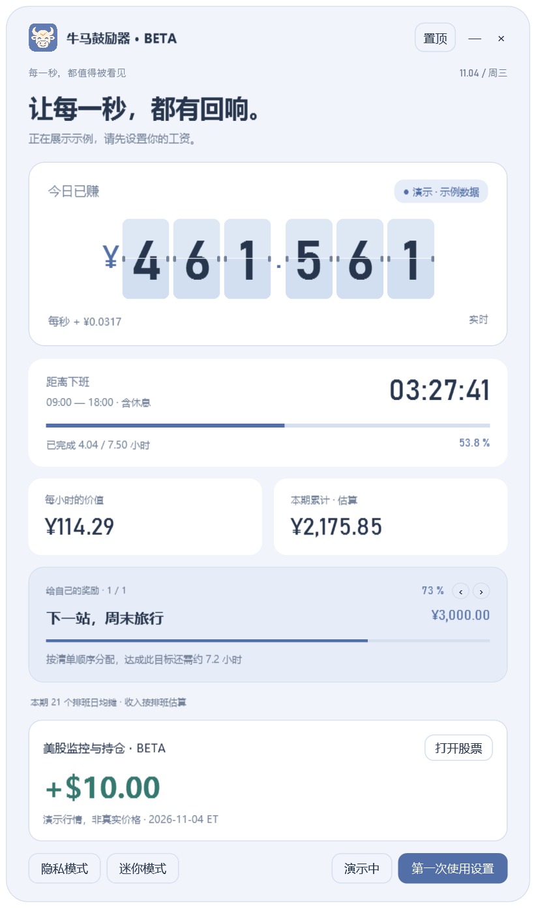
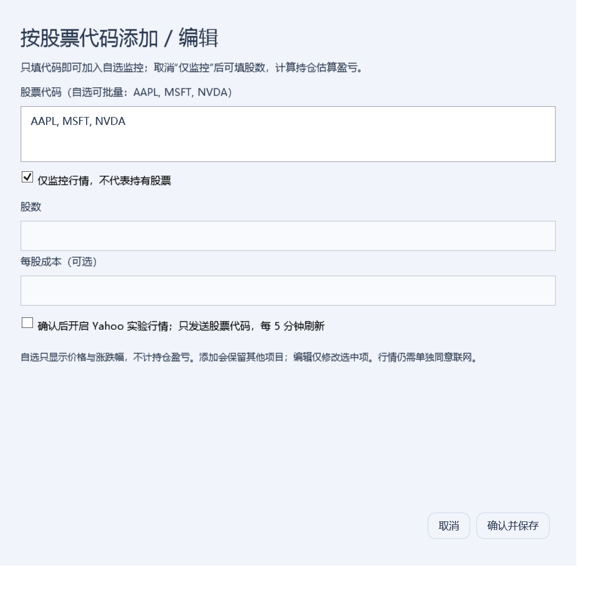
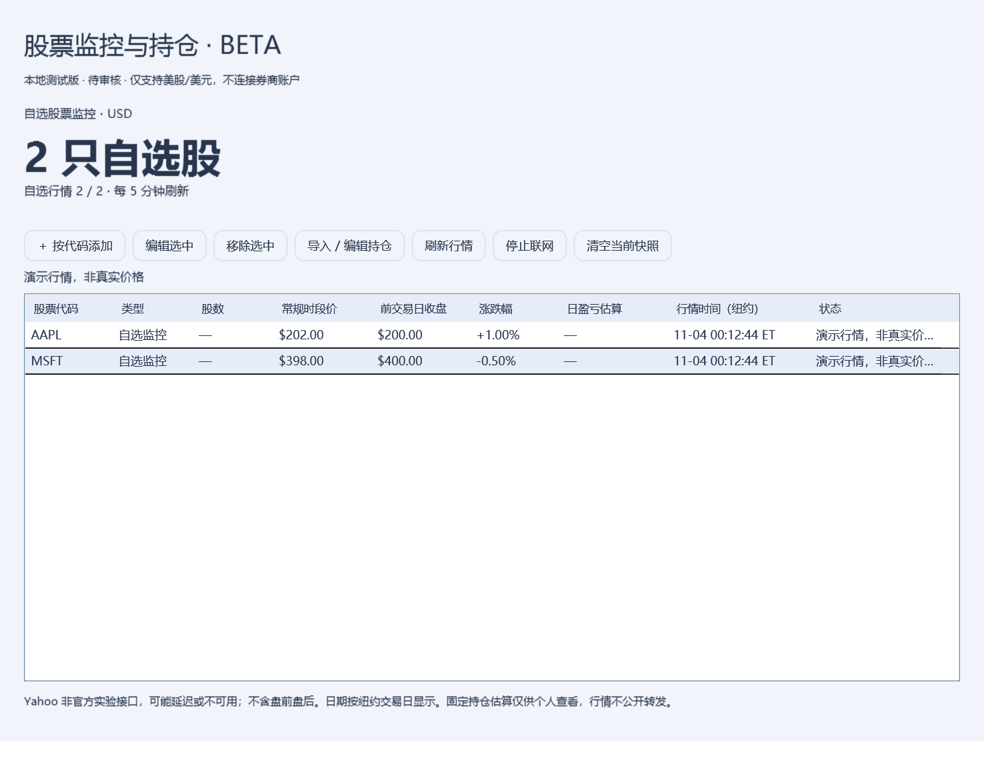

# 美股监控与持仓动力源：预发布版详细说明

版本：**1.5.0-beta.4**。状态：**公开预发布版，股票功能仍在测试；真实券商适配与扩展交互待验证，扩展未上架商店**。

正式版仍是 [1.4.0](https://github.com/thisemailrectrash-cpu/slaves-encourager/releases/tag/v1.4.0)。本测试版使用独立文件夹和独立配置；本文所述股票功能不属于 1.4.0。

核验日期：**2026-11-04，Asia/Shanghai**。数据接口与券商页面会变化，兼容范围以本文和实际测试记录为准。

## 首次开启、底部布局与窗口高度

股票功能默认关闭，主页不显示股票卡片或入口。点击「第一次使用设置」时，先弹出「是否开启股票功能？」：

- 选择「开启股票功能」：设置草稿启用股票，直接打开独立的「股票」标签页。
- 选择「暂不开启」：进入「工资与排班」，股票保持关闭；以后可到「股票」页开启。
- 选择「取消」或关闭弹窗：退出本次首次设置，不保存选择。

完成首次配置后，再打开普通设置不会重复询问；独立「股票」标签页始终可用。页内可开关功能、按代码添加、编辑、移除和通过四种方式导入自选/持仓。新增与导入先修改草稿，点击设置底部「保存并应用」才写入本地持仓；取消设置放弃这些修改。关闭股票开关后保存不会写入未应用的股票草稿。原有主页底部位置和无滚动布局保留。

股票开关已从「工资与排班」移动到「股票」页。beta.2 或更早配置没有这个开关，升级后默认隐藏，需要自行开启。

开启后股票模块位于工资、下班倒计时、奖励目标及说明之后，作为主页最下方的内容。窗口按内容自然高度自动增长；超出屏幕可用高度时，正文等比例缩小到可见区域，标题栏和底部按钮保持原尺寸。主页不使用滚动容器，不需要滚轮或中键滚动，底部股票不会被操作按钮遮住。

迷你模式只显示紧凑工资界面，暂时收起股票卡片；退出迷你恢复底部布局。迷你模式不改变已经开启的功能或行情选择。

设置中关闭股票功能会关闭已打开的股票窗口、取消正在进行的行情请求并暂停后续刷新，保留自选、持仓与此前独立的行情联网选择；重新开启后，只有此前已同意联网时才会恢复刷新。第一次开启功能本身不代替 Yahoo 联网同意项。

  

## 1. 本版实现了什么

可以直接按代码建立**自选监控**，也可以生成一份由用户确认的**固定持仓快照**，再获取美股行情，计算这份固定股数在最近交易日的价格波动盈亏。它作为主页上的独立动力卡片显示，正收益与负收益都有温和提示，不将持仓波动反复加到工资上。

- 支持美元计价的美股股票与 ETF，自选与持仓合计最多 50 个不同代码；持仓允许小数股及带负号的空头股数。
- 四种入口统一走「解析 → 列映射 → 预览 → 用户确认 → 保存」；原始内容可修改，修改后必须重新预览。
- 可选开启 Yahoo 实验行情，默认关闭。保存确认后立即刷新，之后每 5 分钟刷新；手动刷新至少间隔 1 分钟。
- 股票窗口显示代码、类型、股数、常规时段价、前交易日收盘价、涨跌幅、估算日盈亏、纽约行情时间及数据状态。
- 主界面的隐私模式同时隐藏持仓窗口中的股数、价格和盈亏；代码与行情时间仍可见。
- 支持六语言。主页新增的固定标题、入口与正常状态说明继续支持主页文字编辑。

**这不是券商账户连接，也不是券商实际日盈亏。** 本版不读取账号、密码、Cookie、订单或历史成交，不获取现金余额、完整账户总资产，不下单。

## 直接按代码添加：作为股票监控器

无需导出持仓，也无需填写股数。先按上述步骤开启股票功能，再打开主页底部的股票入口，点击「＋ 按代码添加」，输入 `AAPL`，或批量输入 `AAPL, MSFT, NVDA`。支持逗号、分号、空白分隔，自动转为大写，`NASDAQ:AAPL`、`BRK.B` 会规范化。

默认勾选「仅监控行情」，此时股数与成本输入禁用；保存为自选而非持仓。需要行情时勾选联网同意项，确认保存后自动刷新。仅监控模式显示价格、涨跌幅和纽约行情时间，不需要券商账户。界面显示自选数量和有效行情覆盖，不显示虚构的 0 美元收益。

要计算自己持仓的估算日盈亏，取消「仅监控」，每次填写一个代码、非零股数及可选每股成本。选中已有行后可「编辑选中」，修改代码、股数，或在自选和持仓之间切换；「移除选中」只移除该项。编辑保留原顺序和其他条目。

自选与持仓可以混用。自选不参与持仓市值或盈亏合计；缺少某只自选股行情也不会让其他完整持仓的合计失效。自选能显示有效价格但缺少前交易日收盘时，涨跌幅和盈亏显示 `—`，不会补造昨收。

重复代码会提示先编辑，不自动覆盖或合并股数。手动新增会保留其他项目；四种持仓导入方式会替换旧持仓，保留不冲突的自选。若导入了同代码的真实持仓，则该自选项升级为持仓，避免同一代码重复。

配置保持与旧 beta 的持仓条目兼容，缺少 `WatchOnly` 标记的旧项仍视为持仓；包含新自选条目的配置请用 beta.2 或更新版本打开。当前仍限美元美股与 ETF，未实现提醒、自动交易、K 线分析或其他市场。

 

## 2. 四种接入方式

| 方式 | 入口 | 本版支持 | 必须核对 |
| --- | --- | --- | --- |
| ① 券商文件导入 | 导入 / 编辑持仓 → 文件导入 | UTF-8 CSV、TSV、TXT、JSON，以及 XLSX 第一个工作表 | 股票代码、股数、每股成本与币种，是否包含全部账户 |
| ② 复制当前持仓页面 | 选中持仓表格复制 → 粘贴持仓页 | 带制表符的文本、CSV、HTML 表格、双空格分列文本 | 页面分页或虚拟滚动是否遗漏行 |
| ③ 截图 OCR | 截图文件，或粘贴截图 | Windows 本地 OCR，PNG/JPG/JPEG/BMP | O/0、I/1、负号、小数点、代码后缀、列是否错位 |
| ④ 浏览器扩展 | 手动加载扩展 → 读取当前表格 → 复制/保存 JSON → 应用粘贴/导入 | Chrome/Edge Manifest V3；当前已加载且有可识别表头的 HTML/ARIA 表格 | 已加载行数、是否折叠、是否还有其他分页/账户 |

四种方法均已提供实现和虚构样本测试。**尚未逐一登录富途、老虎、长桥、盈透、Schwab、Fidelity、Robinhood 等真实账户验证页面适配，不能宣称覆盖所有券商。** 无表格、画布渲染或受限制页面可以改用文件或截图。

### ① 文件导入

1. 在券商页面自行导出持仓；不需要把账户凭据交给本软件。
2. 点击「导入 / 编辑持仓 → ① 文件导入」。
3. 核对表头行号和四个列选择器；不需要的列不参与持仓解析。
4. 点击「解析并预览」，确认显示的每个代码及股数。
5. 如无币种列，需要勾选确认这些持仓全部为美元美股。
6. 需要行情时，再勾选 Yahoo 实验行情同意项，最后确认替换持仓。

推荐格式：

```csv
Symbol,Quantity,AverageCost,Currency
AAPL,10,150,USD
MSFT,5,300,USD
```

以上为**虚构样本，非真实账户或当前市场价格**。可直接试用 [CSV](../examples/holdings-sample.csv)、[XLSX](../examples/holdings-sample.xlsx)、[表格页面](../examples/holdings-table.html) 或 [OCR 示例图](../examples/holdings-sample.png)。

`Symbol` 和 `Quantity` 必填。`AverageCost` 是**每股**平均成本，可为空；「总成本」「持仓市值」不能当成每股成本。日盈亏不使用成本价，本版保存该字段供核对，不提供完整税务成本或账户累计收益计算。

数字使用英文小数点；千分位须为规范分组，例如 `1,250.5`。CSV 中含逗号的单元格须加双引号。类似 `1.234,50` 的混合格式会拒绝，不会猜测小数含义。`BRK.B` 可规范为行情使用的 `BRK-B`。

重复代码不会悄悄合并；请核对多个账户是否应合并股数并手动处理成本。失败行会明确阻止确认，不会默默跳过。现金、期权、其他市场或非美元行应由用户明确移除或留待后续版本。

XLSX 仅读取第一张表的数据，不执行公式、宏或外部链接；公式单元格会拒绝，请先在 Excel 中粘贴为值。旧 `.xls`、加密工作簿、PDF 券商账单不在本版范围内。文件上限 5 MB，表格上限 1000 行；CSV/粘贴文本上限 200 万字符。

### ② 复制持仓页

复制时尽量包含表头，直接选择持仓表格，不必复制账户名称、地址等其他内容。应用优先处理剪贴板中的 HTML 表格；无表格时解析纯文本。它只在用户点击粘贴时读取剪贴板，不后台监控。

带「Symbol / Quantity」「代码 / 持仓数量」等表头可自动建议列；无法识别时手动指定股票代码列和股数列，再预览。若页面只能复制出一整块无法分列的文字，请改用导出文件或截图。

这里只解析用户主动复制的内容，不执行网页脚本，也不会登录券商。分页、折叠行、虚拟列表可能导致快照不完整，软件无法凭空发现屏幕外的持仓。

### ③ 截图 OCR

1. 截取清晰的持仓表格，包含代码与股数表头，避免遮挡、滚动中截屏或过度缩小。
2. 选择截图文件，或复制截图后点击「粘贴截图」。
3. `StockOcr.exe` 调用 Windows 自带 OCR；图片不会上传至云端。
4. 软件按文字坐标重建表格行，把识别结果放回可编辑文本框。
5. 手动核对，修正代码、小数点、负号和列位置，再解析并确认。

图片上限 10 MB，尺寸须满足系统 OCR 的最大边长；过大时裁剪为清晰表格。优先使用系统已有的英语识别器，其次使用用户已安装的识别语言。缺少系统 OCR/识别语言时会提示改用系统文字识别后粘贴；不安装系统包、不改执行策略。

本机已用虚构 AAPL/MSFT 表格验证 OCR，并修复了按列输出文字时的行重建问题。复杂券商布局、多行单元格或模糊截图仍可能失败。**预览确认不能跳过。** 剪贴板图片的临时文件在识别结束后删除；原始文件不会修改，也不会作为持仓配置保存。

### ④ 浏览器扩展

此扩展是本地测试源码，**没有自动安装到你的浏览器，也未上架商店**。

1. 在 Chrome 打开 `chrome://extensions`，或 Edge 的扩展管理页。
2. 由用户开启开发者模式，选择「加载已解压的扩展程序」，指定便携包内 `browser-extension` 文件夹。
3. 自行登录券商，打开持仓页，展开需要的列表。
4. 点击扩展，再点击「读取当前表格」，选择正确表格。
5. 检查行数和预览，复制到鼓励器，或保存 JSON 后在应用导入。
6. 在应用中核对并确认；扩展本身不会修改持仓或联系行情提供商。

扩展仅申请 `activeTab` 和 `scripting`。点击后临时访问当前页；没有常驻网站权限、后台读取器、Cookie 访问、请求拦截或网络上传。仅导出识别到的代码、股数、可选每股成本与币种列，账户编号等额外列不导出。

它不能绕过站点安全限制、跨源 iframe 或浏览器内部页面限制；只读取已加载行，不自动翻页或滚动抓全账户。超过截取上限时显示截断提示，必须核对完整性。扩展逻辑与最小权限已通过虚构 DOM 测试，真实券商/浏览器安装后的完整流程仍待审核验证。

## 3. 行情和日盈亏口径

```text
固定持仓日波动估算 = 已确认股数 ×（最近常规时段价格 − 前一交易日收盘价）
```

总额只汇总全部有有效行情、同一交易日且均非演示混入的数据。小数股和空头保留方向。显示币种固定为 USD，不与人民币工资直接相加。

虚构示例：AAPL 10 股从 200 变为 202，估算 +20 美元；MSFT 5 股从 400 变为 398，估算 -10 美元，合计 +10 美元。这只是算法示例。

**固定股数可能与当日开盘前股数不同。** 如果当天新买入、卖出、转仓、拆股或分红，当前快照乘以昨收差并不等于券商实际日盈亏。更新快照也不补算已卖出仓位或历史交易。手续费、税费、现金、期权、利息、融资费用、汇率变化与已实现盈亏均不在本版内。

Yahoo 的多日 `chartPreviousClose` 可能是整个区间的基准价。本实现从日线数据寻找**行情交易日之前最近一日的原始收盘价**，不将多日图表基准或每股成本误当昨收，也不使用复权总回报代替当日价格差。

行情日期与时间按 `Eastern Standard Time` 时区规则转换，包含纽约夏令时。周末或休市时可能显示上一交易日，界面明确标明日期，而不是假装今天持续盈利。不含盘前、盘后价格。

## 4. 新鲜度、失败与限速

- 自动 5 分钟刷新；手动至少间隔 1 分钟，最多 3 个并发请求，每个请求超时 12 秒、响应上限 2 MB。
- 本地缓存超过 10 分钟不进入有效汇总；通常工作日纽约 09:30–16:00，行情时间落后超过 20 分钟，或仍为前一日时，保守排除。
- 未内置完整美股节假日日历；假日或异常停牌时可能保守显示不可用，日期与数据状态仍保留，不伪造当前盈亏。
- 错代码、非 USD、非支持的美国交易所、期权/加密品种、未来时间或缺少前收盘时不计算涨跌幅与持仓盈亏；有效价格仍可用于监控。
- HTTP 429、授权/网络错误、格式变化时不绕过登录、验证码或限制。旧行情可作为旧数据保留，但不会以最新值继续计入合计，也不会被替换成 0。
- 部分行情缺失或交易日不同，总盈亏显示 `—`，同时显示有效覆盖数量；单项状态指出待更新。
- 「停止联网」取消正在进行的刷新，关闭并保存联网选择；重新开启需要再次进入持仓确认。关闭程序也停止刷新。清空当前快照会停止联网，原 `.bak` 备份仍保留。

## 5. 数据源与使用范围

当前只实现 **Yahoo Finance 非官方实验 Chart 接口**，仅用于本地个人测试；没有声称它是稳定、授权开放或保证实时的正式 API。连接时仅在请求 URL 发送代码，不发送持仓股数、成本、截图或账户资料。行情提供商仍会接收到正常网络请求信息。

Yahoo 官方说明存在交易所差异及延迟，并限制行情再分发。因此本地测试版没有上传到公开仓库，实际行情响应不会打包为公开样本。发布前需要审核数据使用方式和适合的正式数据服务。

本次公开 AAPL 接口连通与前交易日基准已验证。Stooq 探测虽返回 HTTP 200，实际为浏览器验证页面，不是 CSV，所以未把它作为可用自动备用源，也没有绕过验证。

后续可接官方 Alpaca 等提供商；Alpaca 文档说明免费实时源为 IEX，不能当作全美市场综合实时行情。本版尚未实现该适配，也不要求你提供 API 密钥。

资料核验于 2026-11-04：

- [Yahoo：交易所、数据提供商与延迟说明](https://help.yahoo.com/kb/SLN2352.html)
- [Alpaca：股票 snapshot 字段](https://docs.alpaca.markets/us/reference/stocksnapshotsingle)
- [Alpaca：免费 IEX 与 SIP 行情范围](https://docs.alpaca.markets/us/docs/market-data-faq)
- [Microsoft：Windows OCR RecognizeAsync](https://learn.microsoft.com/en-us/uwp/api/windows.media.ocr.ocrengine.recognizeasync)
- [Chrome：activeTab 用户触发权限](https://developer.chrome.com/docs/extensions/develop/concepts/activeTab)
- [Chrome：scripting API](https://developer.chrome.com/docs/extensions/reference/api/scripting)

## 6. 本地数据与正式版隔离

测试版工资设置：`%LOCALAPPDATA%\SlavesEncouragerStockBeta\settings.json`。

测试版固定持仓：`%LOCALAPPDATA%\SlavesEncouragerStockBeta\portfolio.json`，原子保存并保留 `.bak`，未加密；不保存账户密码。原始粘贴内容和截图不写入该文件。行情缓存在内存，重启后需重新获取。

主页的工资演示按钮只切换工资示例；股票行情仍遵循其独立的联网选择。隐私模式同时隐藏两者的数字。

正式版的 `%LOCALAPPDATA%\NiumaFlip\settings.json` 不会被本测试版读取或改写。首次打开 beta 需自行设置工资或只测试股票入口。隐私模式隐藏界面数字，不等于磁盘加密。

## 7. 审核清单与后续市场

审核前保留本地状态，不推送 beta 源码，不创建 beta Release，不自动安装扩展。

待审核事项：四种入口的真实券商样本与列适配；虚拟列表完整性；OCR 误识别率；用户对固定股数估算的理解；Yahoo 数据使用与替代服务选择；行情失败/延迟显示；Windows 不同版本与 DPI；扩展安装后的真实浏览器交互。测试中请使用脱敏或虚构数据，不必提交账号、密码或密钥。

后续港股、A 股等需单独实现代码命名、币种、交易日历、时区、数据授权及公司行为处理。当前会拒绝这些市场，不能仅换代码后缀就当作已经支持。

## English overview

This is a **local-only, review-pending US stock beta**, separate from published 1.4.0. First-time setup asks whether to enable stocks. Yes selects the dedicated Stocks tab, Not now selects salary setup, and Cancel aborts. Subsequent settings visits do not repeat the question. Stock-tab additions, edits and imports remain isolated drafts until settings are saved; cancelling discards them. The home module sits last, grows the window, and fits short screens without scrolling. Hiding the feature suspends quote requests while preserving data and prior consent. Add one or several symbols directly for a watchlist without owned shares. Enter shares only for actual holding estimates. Watch entries never enter holding PnL; selected rows can be edited, converted or removed, and holding imports preserve nonconflicting watch entries. Four implemented routes—file import, pasted tables, Windows local OCR and a user-triggered MV3 extension—feed an editable preview and explicit snapshot confirmation. No brokerage login, orders, cash or trade synchronization is involved.

Only confirmed fixed quantities and USD US stocks/ETFs are supported. Experimental Yahoo quotes refresh every five minutes after opt-in. Estimated daily market movement is quantity times regular-session price minus the preceding trading-session close; it is not actual brokerage day PnL. Cost, trades, fees, tax, FX and corporate actions are not reconciled. Quotes use New York dates, and incomplete, stale, mixed-session or simulated/live mixed data never produce a complete total.

Windows OCR runs locally in `StockOcr.exe`; no screenshots are uploaded. The extension exports only recognized holdings columns on user invocation, with `activeTab` and `scripting`, no persistent host access or network client. Generic table support is implemented; individual real brokerage integrations and extension click-through remain unverified.

Portfolio and salary settings use a separate beta directory. PnL remains a separate motivation source and never changes salary, expense coverage or reward allocations. The audited source and synthetic samples are available as a public prerelease authorized on 2026-11-04. Real holdings and market responses are excluded. Data licensing, real broker layouts and extension click-through remain review items before promoting to stable.
